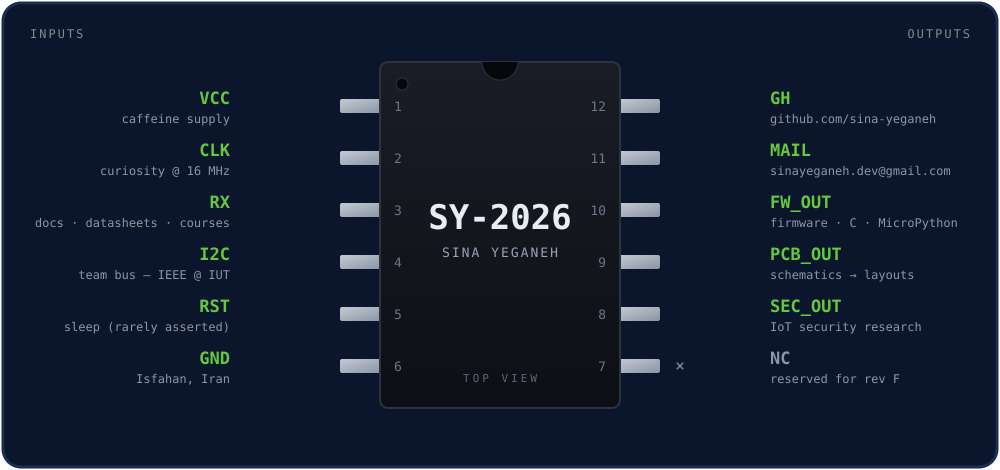

<p align="center">
  
</p>

<p align="center">
  <b>SY-2026</b> · Embedded &amp; IoT-Security Engineer · <b>Rev E</b><br>
  <sub>PRELIMINARY DATASHEET — specifications subject to change without notice (this device is still learning)</sub>
</p>

<p align="center">
  
  
  
  
</p>

<p align="center"><i><b>Free Palestine! 🇵🇸</b></i></p>

<p align="center">
  <sub>
    <a href="#1-features">1 Features</a> ·
    <a href="#2-description">2 Description</a> ·
    <a href="#3-pin-configuration">3 Pins</a> ·
    <a href="#4-specifications">4 Specs</a> ·
    <a href="#5-applications">5 Applications</a> ·
    <a href="#6-device-support">6 Toolchain</a> ·
    <a href="#7-revision-history">7 Revisions</a> ·
    <a href="#8-ordering-information">8 Contact</a>
  </sub>
</p>

---

## 1 Features

- **Embedded systems** — microcontrollers, ESP32, firmware in C and MicroPython
- **PCB design** — from schematic capture to a routed board (Altium)
- **IoT security** — breaking and hardening connected devices, heading for bug bounty
- **Low-level programming** — registers over abstractions, close to the metal
- **Web toolchain** — Python, Flask, JavaScript and React for dashboards and tools
- **Linux native** — Debian, Kali, Parrot, Ubuntu
- Co-founder of **Madarafzar Hooshmand Isfahan** — IoT · embedded · PCB
- Member of the **IEEE Student Branch** at Isfahan University of Technology

## 2 Description

The **SY-2026** is an electrical engineering student at **Isfahan University of Technology (IUT)**
who designs boards, writes the firmware that runs on them, and then tries to break both.

It shipped as a web developer and has been migrating down the stack ever since: from browsers
to Linux, from Linux to microcontrollers, and from microcontrollers to the question every
hardware person eventually asks — *"okay, but how would I attack this?"*

Target spec by graduation: seriously good at **embedded security, IoT security and PCB design**.

## 3 Pin Configuration

<p align="center">
  
  <br><sub><i>Figure 3-1. SY-2026 pin configuration (top view)</i></sub>
</p>

<sub><i>Table 3-1. Pin functions</i></sub>

| Pin | Name | Type | Description |
|:---:|:---|:---:|:---|
| 1 | `VCC` | P | Caffeine supply |
| 2 | `CLK` | I | Curiosity, free-running |
| 3 | `RX` | I | Docs, datasheets, courses, CTF write-ups |
| 4 | `I2C` | I/O | Team bus — IEEE Student Branch @ IUT |
| 5 | `RST` | I | Sleep. Active low, rarely asserted |
| 6 | `GND` | P | Isfahan, Iran |
| 7 | `NC` | — | Reserved for rev F |
| 8 | `SEC_OUT` | O | IoT security research |
| 9 | `PCB_OUT` | O | Schematics → layouts → boards |
| 10 | `FW_OUT` | O | Firmware in C / MicroPython |
| 11 | `MAIL` | I/O | [sinayeganeh.dev@gmail.com](mailto:sinayeganeh.dev@gmail.com) |
| 12 | `GH` | I/O | [github.com/sina-yeganeh](https://github.com/sina-yeganeh) |

## 4 Specifications

### 4.1 Absolute Maximum Ratings

> Stresses beyond those listed may cause permanent damage to the device.

| Parameter | Min | Max | Unit |
|:---|:---:|:---:|:---:|
| Sleep | 4 | — | h / night |
| Concurrent side projects | — | 8 | projects |
| Open browser tabs | — | 147 | tabs |
| Deadline proximity before panic mode | 6 | — | h |
| Ambient temperature (Isfahan summer) | — | 42 | °C |

### 4.2 Recommended Operating Conditions

| Parameter | Typ |
|:---|:---|
| OS | Linux (Debian-based) |
| Editor | VS Code |
| Interface languages | Persian · English |
| Timezone | UTC+03:30 (Asia/Tehran) |

### 4.3 Electrical Characteristics

<sub><code>PRODUCTION</code> = shipped and stable · <code>ACTIVE</code> = in heavy use · <code>SAMPLING</code> = under evaluation in the lab · <code>PREVIEW</code> = on the roadmap</sub>

| Block | Parameters | Status |
|:---|:---|:---:|
| Embedded | C · MicroPython · ESP32 · sensors (I²C/SPI) |  |
| Hardware | PCB design · Altium · analog &amp; digital electronics |  |
| Security | IoT security · Linux pentesting · OSINT |  |
| Security | Bug bounty |  |
| Web | Python · Flask · JavaScript · React · HTML/CSS |  |
| Systems | Bash · Linux · MySQL · Git |  |

### 4.4 Typical Characteristics

<p align="center">
  
  <br><sub><i>Figure 4-1. Proficiency vs. revision</i></sub>
</p>

## 5 Applications

### 5.1 Typical Application — VitalBand

A wearable vital-signs monitor for crisis and field environments: heart rate, SpO₂ and temperature.

```text
 ┌──────────┐   I²C   ┌───────────┐  Wi-Fi / BLE  ┌────────────┐
 │ MAX30102 │ ──────▶ │   ESP32   │ ────────────▶ │ dashboard  │
 │ PPG/SpO₂ │         │ DSP + FW  │               │  + alerts  │
 └──────────┘         └───────────┘               └────────────┘
```

<sub>The trace on the scope at the bottom of this page is its PPG channel.</sub>

### 5.2 Other Applications

| Application | Description | Status |
|:---|:---|:---:|
| **Madarafzar Hooshmand** | Co-founded company in Isfahan — IoT, embedded systems, microcontrollers and PCB design |  |
| **Rezerv-Yar** | Browser extension that auto-reserves next week's meals on the IUT dining system |  |
| **MediCase** | AI clinical-simulation web app for medical students (team project) |  |

## 6 Device Support

<p align="center">
  
</p>

## 7 Revision History

| Rev | Changes |
|:---:|:---|
| **E** | *Current.* Focus moved to embedded security, IoT security and PCB design. VitalBand in development |
| D | Co-founded Madarafzar Hooshmand Isfahan |
| C | Started Electrical Engineering at IUT, joined the IEEE Student Branch |
| B | Moved to Linux full-time, started hacking on TryHackMe |
| A | Initial release: web development with Python, Flask, JavaScript and React |

## 8 Ordering Information

To order, collaborate, or report a bug in this device:

<p align="center">
  <a href="mailto:sinayeganeh.dev@gmail.com"></a>
  <a href="https://github.com/sina-yeganeh"></a>
</p>

---

<p align="center">
  
</p>

<p align="center">
  <sub><b>IMPORTANT NOTICE</b> — This device is provided "as is". No warranty, express or implied.</sub>
</p>
<p align="center">
  <sub>May run hot near deadlines and occasionally reboot into a new side project. © 2026 Sina Yeganeh</sub>
</p>
